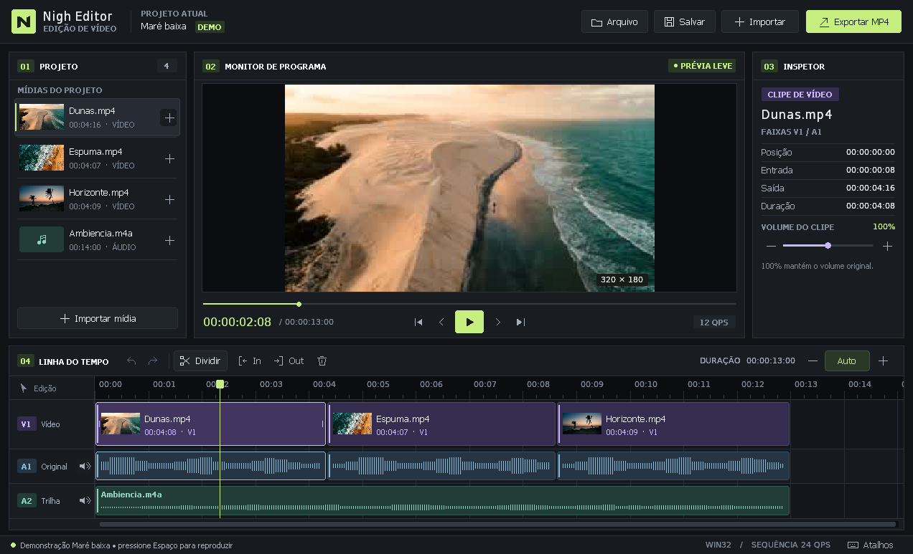

# Nigh Editor

Editor de vídeo portátil para Windows x86, pensado para a geração do Pentium M. Tem biblioteca, monitor de fonte, monitor de programa, inspetor e linha do tempo inspirados no fluxo de trabalho do Premiere, com nome e interface próprios. É uma primeira versão funcional, não uma reprodução integral do Premiere Pro.



## Usar o programa compilado

1. Baixe e extraia **[Nigh Editor 0.1.0 para Windows de 32 bits](https://github.com/Eliene-byte/Nigh-editor/releases/download/v0.1.0/Nigh-Editor-0.1.0-Windows-x86.zip)**.
2. Abra `Nigh Editor/NighEditor.exe`. Mantenha `ffmpeg.exe` e `ffprobe.exe` na mesma pasta.
3. Clique em **Abrir demo** para conhecer o editor com a sequência *Maré baixa*, ou em **Importar** para abrir suas mídias.
4. Arraste um arquivo da biblioteca para a linha do tempo (ou use **+**). Arraste o meio para mover ou as bordas para aparar.
5. Use **Salvar** para o projeto `.nigh`, ou **Exportar MP4** para gerar um vídeo em **360p** ou **480p**.

| No editor | O que faz |
| --- | --- |
| **V1 / A1** | Vídeo com cortes consecutivos; o áudio original acompanha o clipe. |
| **A2** | Áudio independente com posição, cortes, volume e silêncio por faixa. |
| **Espaço**, **← / →** | Reproduzir/pausar e navegar quadro a quadro no monitor ativo. |
| **C**, **I / O**, **Delete** | Dividir, aparar no cursor de edição e remover o clipe selecionado. |
| **Ctrl+Z / Y**, **Ctrl+roda**, **F1** | Desfazer/refazer, zoom da linha do tempo e ajuda. |

Os `.nigh` armazenam referências aos originais e as decisões de edição, não os vídeos. Para reabrir um projeto, mantenha os originais no lugar. Arquivos na pasta do projeto são referenciados relativamente. A prévia é recriada quando você reabre um projeto.

## Perfil de hardware

- **Alvo:** Windows XP SP3 de 32 bits ou Windows posterior capaz de executar Win32, com processador **SSE2** (por exemplo, Pentium M). Use de preferência **1 GB de RAM** e uma tela de pelo menos **1024 × 600**. Nenhuma medição foi feita num notebook real de 2005.
- O editor usa **Win32/GDI e waveOut**, não um navegador embutido. Não precisa de conta, rede, GPU dedicada, .NET nem instalação do FFmpeg no sistema.
- O editor decodifica na hora apenas a prévia **320 × 180, 12 qps**, em quadros JPEG independentes. O áudio da prévia é PCM mono. Ambos são gerados sob demanda na pasta temporária e descartados ao fechar normalmente.
- A exportação **H.264 + AAC estéreo** usa a mídia original, em **24 qps**. Para preservar memória, renderiza um clipe por vez e faz a mixagem em blocos. Em um Pentium M, importe e exporte arquivos SD; material pesado, como HEVC e 4K, pode levar muito tempo ou exceder a memória.
- Formatos comuns de entrada: MP4/H.264, MOV, AVI/DV, MKV/WebM, MPG, WMV, WAV, MP3, M4A, FLAC e Ogg. A compatibilidade depende do codec dentro do arquivo. Nesta versão não há efeitos, legendas, transições, sobreposição de trilhas de vídeo ou exportação de projeto só de áudio. Limites: **2 h** por mídia/sequência, **128** mídias e **256** clipes por trilha editável.

## Compilar no GitHub

O fluxo [Windows x86](.github/workflows/windows-x86.yml) compila o editor e os codecs, verifica o ZIP e testa a importação, a edição e as duas exportações em um runner Windows. As compilações de desenvolvimento ficam nos artefatos da execução. Os downloads públicos ficam em [Releases](https://github.com/Eliene-byte/Nigh-editor/releases).

Para publicar, envie um commit cuja primeira linha seja `release: vX.Y.Z`, com a mesma versão do ZIP gerado por `tools/package.sh`. Com o fluxo na branch padrão, também é possível executá-lo manualmente com a opção **publicar**. A release só é criada depois que o pacote passa nos testes, e a tag aponta para o commit que gerou os binários.

## Compilar no Linux

Use GNU Make, Bash, `curl`, `tar`, `zip`, Python 3, um C++ nativo para os testes e MinGW-w64 i686 **com MSVCRT e runtime compatível com XP**. Para reproduzir a toolchain usada no pacote em Linux x86-64:

```sh
export PATH="$(bash tools/bootstrap-mingw.sh):$PATH"
make -j2 all             # build/NighEditor.exe
make test                # modelo de edição, nativo no host
make -j2 package         # motor + executável + demo + licenças em artifacts/
```

O script baixa e verifica as fontes fixadas de FFmpeg 4.4.8/x264. O motor é compilado sem rede e executado em processos separados. O ZIP inclui os avisos e o código-fonte correspondente dos codecs. O pacote não é assinado e o `.sha256` permite conferir a integridade do download.

### Verificação

```sh
make audit       # arquitetura PE32, versão 5.01 e DLLs importadas
make smoke       # build/smoke.exe — teste de integração para Win32
mkdir -p build/smoke-out
LC_ALL=C.UTF-8 wine build/smoke.exe build/codecs demo build/smoke-out
```

O teste de integração importa a demonstração (incluindo caminho com acentos), decodifica prévias, executa cortes e reordenação, salva e reabre o projeto, testa a mixagem, confere as cores da prévia e exporta 360p/480p. O motor e a integração x86 foram executados no Wine em modo XP; a interface também foi revisada no Wine. Nenhum desses testes substitui rodar o pacote em Windows XP físico.
